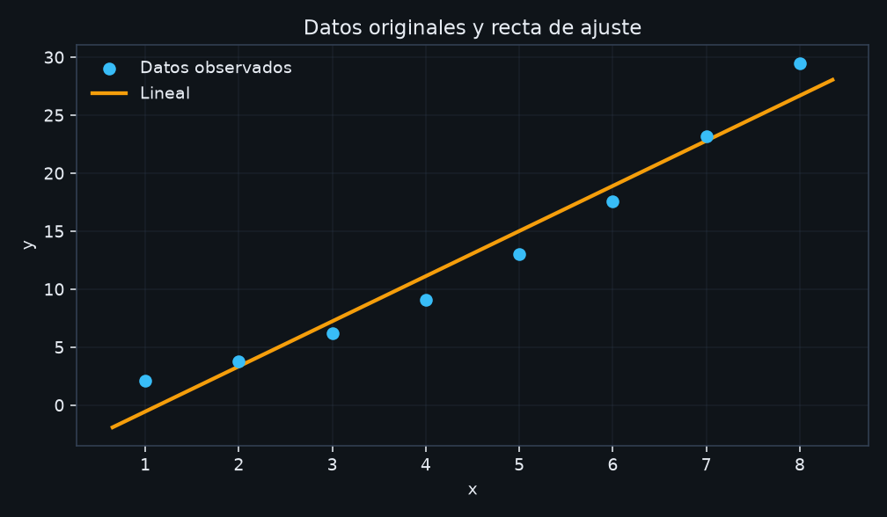
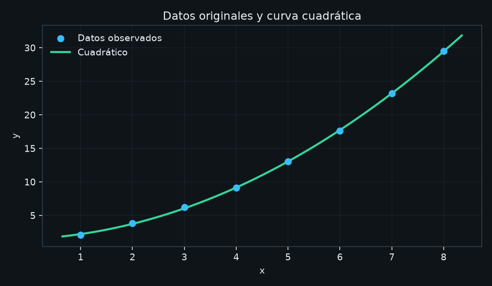
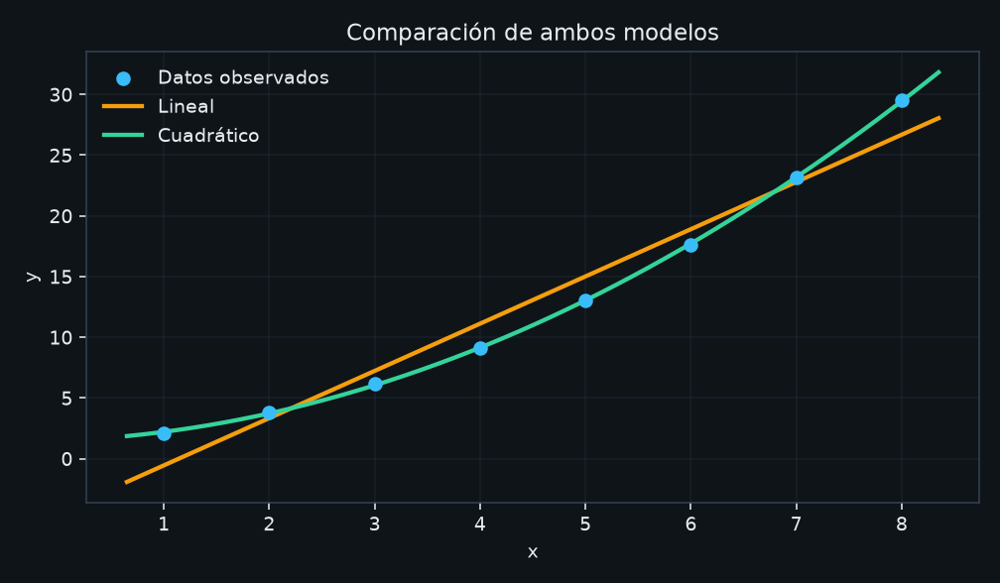

# AproxLab

Calculadora de escritorio para **aproximación funcional** por mínimos cuadrados: recta y polinomio de segundo grado, comparación de modelos y gráficas científicas.

Proyecto de Métodos Numéricos pensado también como pieza de portafolio: el motor matemático se prueba sin GUI, la interfaz usa PySide6 con separación MVP, y las decisiones de diseño están documentadas (no inventadas a posteriori).

## Objetivo y problemática

Dado un conjunto de pares \((x_i, y_i)\), se busca una función simple que describa la tendencia. La guía APE 04 exige:

1. Ingreso y validación de datos.
2. Ajuste lineal y reporte de \(a_0\), \(a_1\), ecuación, SSE, SST, \(S_{yx}\), \(R^2\) y \(r\).
3. Ajuste cuadrático \(y = a_0 + a_1 x + a_2 x^2\) con \(\hat y\), residuos y SSE.
4. Comparación de ambos modelos.
5. Tres gráficas (recta, parábola, comparativa).
6. Diagramas de flujo alineados con el código.

Un menor SSE del polinomio **no** implica automáticamente un mejor modelo predictivo: la parábola contiene a la recta como caso particular (\(a_2 = 0\)). La aplicación lo deja explícito.

## Funcionalidades

- Tabla editable de pares \((x, y)\): agregar, editar y eliminar filas.
- Validación: misma longitud, valores numéricos finitos, \(n\) suficiente y \(x\) no degenerados.
- Regresión lineal y cuadrática por `numpy.linalg.lstsq` (sin invertir \(X^\top X\)).
- Comparación por SSE, con \(S_{yx}\) y \(R^2\) ajustado como apoyo.
- Gráficas Matplotlib embebidas (leyenda, ejes, título).
- Exportar reporte `.txt` y gráficas PNG.
- Tres conjuntos de ejemplo (incluidos los canónicos de la guía).
- Tema oscuro por defecto y tema claro.
- Página de fórmulas e interpretación de indicadores.

## Tecnologías

| Pieza | Tecnología |
|-------|------------|
| Lenguaje | Python ≥ 3.11 |
| GUI | PySide6 (Qt Widgets) |
| Álgebra | NumPy |
| Gráficas | Matplotlib |
| Pruebas | pytest |
| Lint / formato | Ruff |
| Empaquetado | PyInstaller (opcional) |

Sin servidores, APIs ni base de datos. Todo corre en local.

## Capturas

Gráficas generadas con el conjunto de ejemplo *Crecimiento de laboratorio* (mismos servicios que usa la GUI):





## Arquitectura

```text
UI (MVP, PySide6)
  └── AnalysisPresenter
        └── AnalysisService
              ├── validation
              ├── LinearRegression / QuadraticRegression (Strategy)
              ├── metrics
              └── compare_models
```

El paquete `aproxlab.core` **no** importa Qt ni Matplotlib. Las pruebas del motor no abren ventanas.

Detalle: [`docs/architecture/decisions.md`](docs/architecture/decisions.md)  
Contrato Qt: [`docs/QT_CONTRACT.md`](docs/QT_CONTRACT.md)  
Trazabilidad APE 04: [`docs/architecture/traceability.md`](docs/architecture/traceability.md)

## SOLID (solo lo que el código usa)

- **SRP:** ajustar, medir, comparar y pintar viven en módulos distintos.
- **OCP / Strategy:** un modelo nuevo implementa `fit` y entra a la fábrica `create_strategy`.
- **LSP:** lineal y cuadrático devuelven el mismo `FitResult`.
- **ISP:** el protocolo de estrategia no arrastra métodos de GUI.
- **DIP:** el presenter depende del servicio y de resultados, no al revés.

## Patrones

- **MVP** para no calcular en los widgets.
- **Strategy + fábrica simple** para los algoritmos de ajuste.
- **Observer** con señales/slots (`analysis_ready`, `analysis_failed`).

No hay Repository: no hay persistencia estructurada más allá de CSV.

## Métodos numéricos

**Lineal.** Se resuelve \(\min_a \|Xa - y\|_2\) con \(X = [\,1 \mid x\,]\).  
SSE \(= \sum (y_i-\hat y_i)^2\), SST \(= \sum (y_i-\bar y)^2\), \(R^2 = 1-\mathrm{SSE}/\mathrm{SST}\) si SST \(> 0\),  
\(S_{yx} = \sqrt{\mathrm{SSE}/(n-2)}\) si \(n>2\), \(r\) = Pearson\((x,y)\).

**Cuadrático.** \(X = [\,1 \mid x \mid x^2\,]\), mismos residuos; \(S_{yx}\) usa \(n-3\).

**Casos degenerados.** \(n\) insuficiente, \(x\) constante, \(y\) constante (\(R^2\) indefinido), datos no finitos.

## Inicio rápido (después de clonar)

Requisito: **Python 3.11 o superior** (`python --version`).

### Windows (PowerShell)

```powershell
git clone https://github.com/<usuario>/<repositorio>.git
cd <repositorio>

python -m venv .venv
.\.venv\Scripts\Activate.ps1
python -m pip install -U pip
pip install -e ".[dev]"

python -m aproxlab.main
```

Si PowerShell bloquea la activación del entorno:

```powershell
Set-ExecutionPolicy -Scope CurrentUser RemoteSigned
```

Luego vuelve a ejecutar `.\.venv\Scripts\Activate.ps1`.


Datos canónicos de la guía:

- Lineal: `x = [0,1,2,3,4]`, `y = [1,3,5,7,9]` → pendiente 2, intercepto 1, SSE 0, \(R^2=1\), \(r=1\).
- Cuadrático: `y = [1,2,5,10,17]` → \(y = 1 + x^2\).

Están en **Ejemplos** del menú y en `examples/`.

## Diagramas de flujo

Ocho diagramas Mermaid en [`docs/flowcharts/`](docs/flowcharts/), alineados con las funciones del código.

| Guía | Archivo |
|------|---------|
| **7. Flujo general** (inicio → menú → datos → métodos → resultados → salida) | [`01-general.md`](docs/flowcharts/01-general.md) |
| 8. Ingreso y validación | [`02-ingreso-validacion.md`](docs/flowcharts/02-ingreso-validacion.md) |
| 8. Ajuste lineal | [`03-ajuste-lineal.md`](docs/flowcharts/03-ajuste-lineal.md) |
| 8. Ajuste cuadrático | [`04-ajuste-cuadratico.md`](docs/flowcharts/04-ajuste-cuadratico.md) |
| 8. Errores e indicadores | [`05-errores-indicadores.md`](docs/flowcharts/05-errores-indicadores.md) |
| 8. Comparación | [`06-comparacion-modelos.md`](docs/flowcharts/06-comparacion-modelos.md) |
| 8. Gráficas | [`07-graficas.md`](docs/flowcharts/07-graficas.md) |
| 8. Menú principal | [`08-menu-principal.md`](docs/flowcharts/08-menu-principal.md) |

GitHub renderiza el Mermaid al abrir cada archivo. Para Word/PDF: copiar el bloque en [mermaid.live](https://mermaid.live) y exportar PNG.
