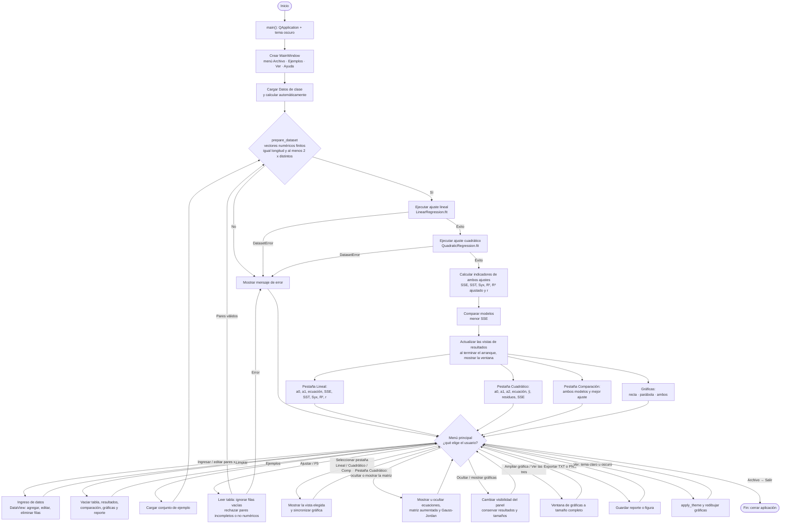

# Diagrama de flujo general del sistema

Requisito 7 de la guía APE 04: desde el **inicio** hasta la **salida**, con menú principal, ingreso de datos, selección de opciones, ejecución de los métodos, presentación de resultados y finalización.

Código al que corresponde:

- `aproxlab.main:main`
- `MainWindow` (menú, toolbar, pestañas, Ajustar)
- `DataView` / `DatasetTableModel.numeric_pairs`
- `AnalysisPresenter.calculate`
- `AnalysisService.analyze`
- `LinearRegression.fit` · `QuadraticRegression.fit`
- `compute_metrics` · `compare_models`
- `ChartsView.show_report`
- `MainWindow.close` / Archivo → Salir

## Lectura para la entrega

1. El programa arranca en `main`, crea la ventana y el **menú principal**, carga los **Datos de clase** y los analiza.
2. El usuario **ingresa datos**, carga un ejemplo o pulsa **Limpiar** para dejar la tabla y los resultados vacíos.
3. **Selecciona** Ajustar (u otra opción del menú).
4. Se **ejecutan** validación, lineal, cuadrático, métricas y comparación. El análisis conjunto requiere al menos tres puntos con tres valores distintos de x; cada estrategia valida sus requisitos.
5. Se **presentan** coeficientes, indicadores, conclusión y las tres gráficas.
6. El ciclo vuelve al menú hasta **Salir**.

Ocultar la matriz o las gráficas no ejecuta otra regresión. La exportación requiere un reporte previo; después de Limpiar se debe calcular de nuevo. Los errores se presentan en Datos y en la barra de estado, sin borrar automáticamente las vistas anteriores.
