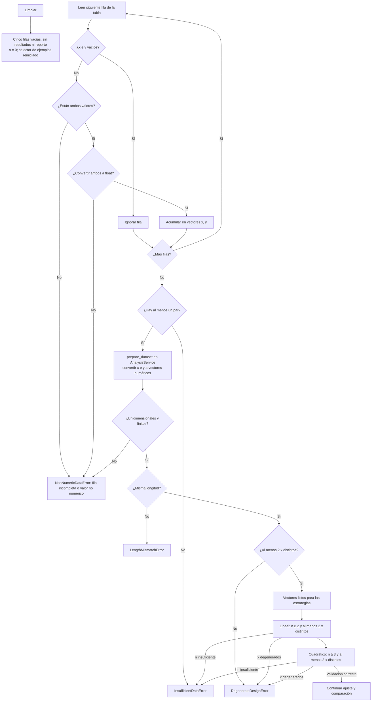

# Ingreso y validación de datos

Corresponde a `DatasetTableModel.numeric_pairs`, `prepare_dataset` y las validaciones de cada estrategia (`require_min_points` y valores distintos de x). La tabla admite punto o coma como separador decimal.

Los ejemplos y CSV cargados mediante el Presenter entregan vectores al servicio; no pasan por la lectura de filas de `numeric_pairs`. La GUI actual carga ejemplos, pero no expone un botón de importación CSV. El análisis conjunto solo produce un reporte cuando los dos ajustes terminan correctamente.
