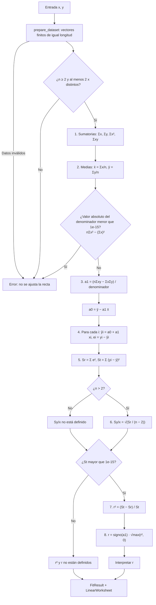

# Ajuste lineal

Corresponde a `LinearRegression.fit` (sumatorias a mano, sin NumPy ni lstsq).

Esta estrategia admite dos puntos; el análisis completo de la GUI también ejecuta la estrategia cuadrática y requiere al menos tres. `LinearWorksheet` contiene el desarrollo que muestra la vista; `AnalysisService` calcula además las métricas compartidas con `compute_metrics`.
