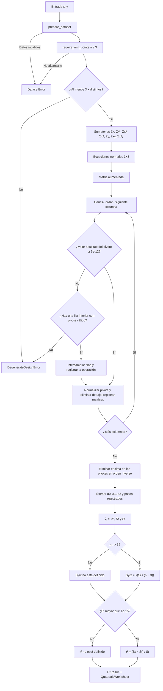

# Ajuste polinomial de segundo grado

Corresponde a `QuadraticRegression.fit`. El sistema se arma y se resuelve a mano.

En la pestaña Cuadrático, el botón **Ocultar / Mostrar cálculo de la matriz** solo esconde o vuelve a mostrar las ecuaciones normales, la matriz aumentada y el Gauss-Jordan. El ajuste se calcula igual en los dos casos. El botón se deshabilita cuando no hay un resultado y conserva la preferencia de visibilidad después de Limpiar.

`gauss_jordan_steps` lanza `ZeroDivisionError` si no encuentra pivote válido; la estrategia lo convierte en `DegenerateDesignError`. El desarrollo incluye sumatorias, matriz inicial, operaciones y errores. Ocultar la matriz conserva esos resultados y permite volver a mostrarlos sin llamar al núcleo.
