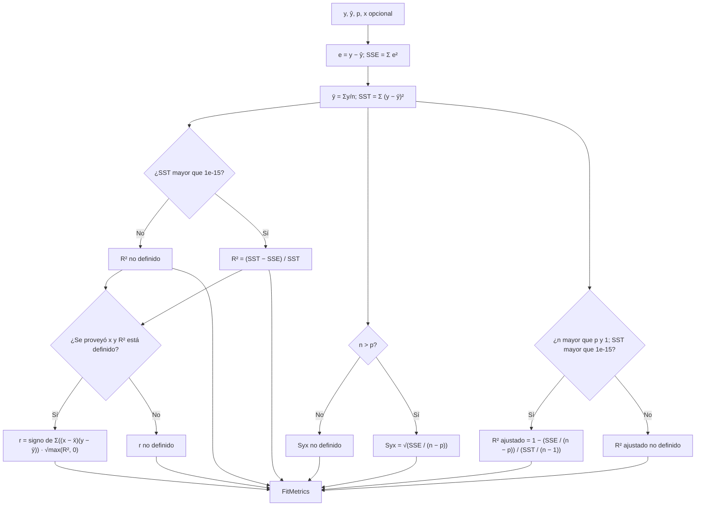

# Cálculo de errores e indicadores

Corresponde a `compute_metrics` y `_signed_r`. `p` es el número de parámetros: 2 para la recta y 3 para la parábola.

El signo de la covarianza se toma como positivo cuando es cero. Para la recta de mínimos cuadrados con intercepto, este cálculo de r coincide con Pearson. El servicio también invoca la función para el cuadrático; ese valor **no debe interpretarse como Pearson de x e y**. La comparación utiliza `linear_metrics.correlation` y la vista cuadrática solo interpreta R². Los grados de libertad n − p determinan cuándo Syx y R² ajustado están definidos.
