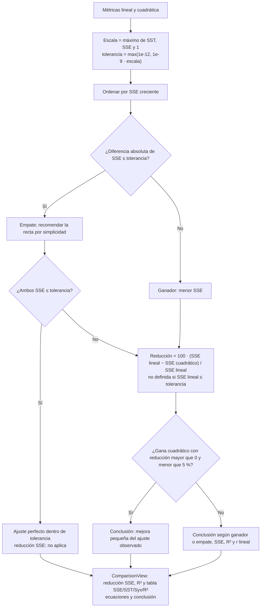

# Comparación de modelos

Corresponde a `compare_models`, `narrate_comparison` y `ComparisonView`.

La tolerancia depende de los valores absolutos de ambos SST y SSE. `compare_models` conserva los valores originales y añade una nota sobre el anidamiento de modelos. El motor calcula R² ajustado, aunque la tabla actual no lo muestra. La conclusión describe ajuste sobre la muestra; una reducción de SSE no prueba por sí sola mejor predicción.
