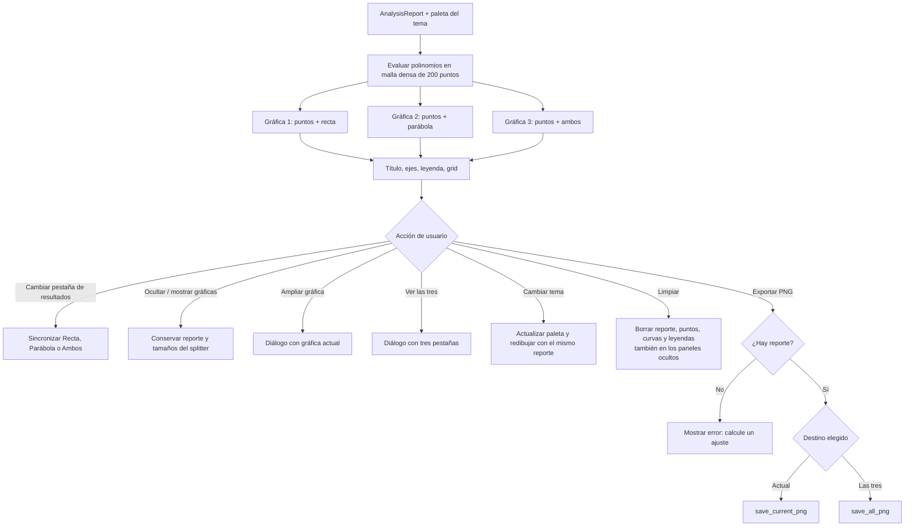

# Generación de gráficas

Corresponde a `dense_curve`, `plot_scatter_and_fits`, `ChartsView` y los controles de gráficas de `MainWindow`. Se usan los coeficientes del reporte, sin volver a ajustar los modelos.

Los diálogos ampliados son modales y se abren solo con un reporte. Al cambiar la pestaña Lineal/Cuadrático/Comparación se selecciona Recta/Parábola/Ambos; el usuario también puede cambiar la pestaña de la gráfica por separado. Exportar o cambiar el tema no recalcula regresiones.
