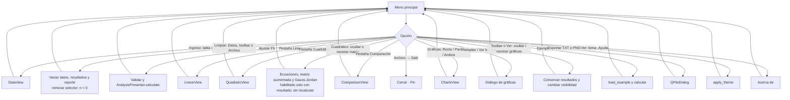

# Menú principal

Corresponde a `MainWindow._build_menus`, la barra de ejemplos y las pestañas del banco de trabajo.

Al iniciar se carga **Datos de clase** y se calcula el primer reporte. Las opciones del diagrama abarcan menús, toolbar, controles de Datos y pestañas. Archivo contiene exportación TXT, PNG actual, las tres PNG, Limpiar y Salir; Ver contiene temas y visibilidad de gráficas. No hay una opción de importación CSV en el menú actual.
